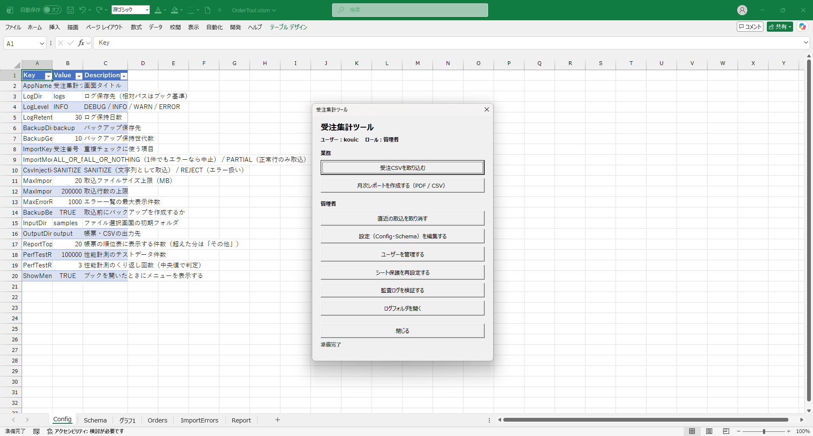
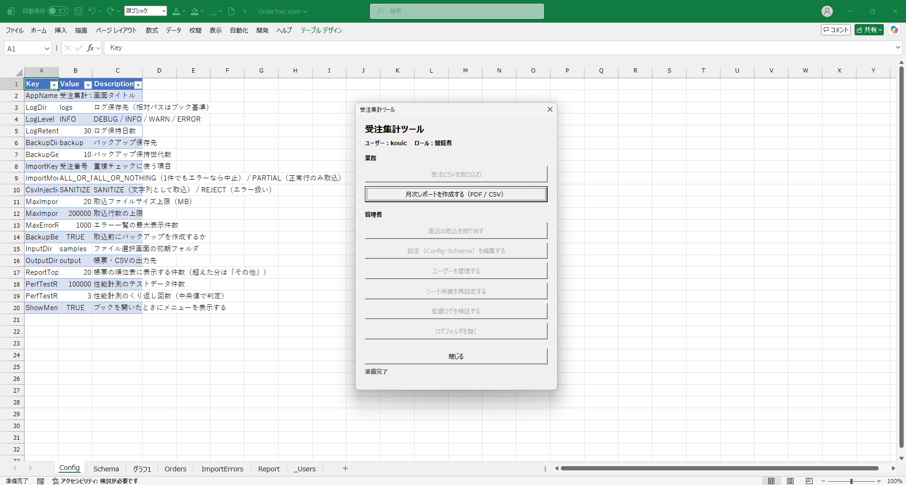
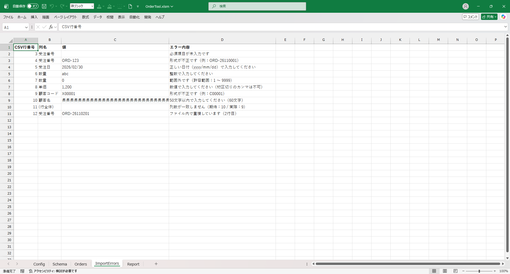
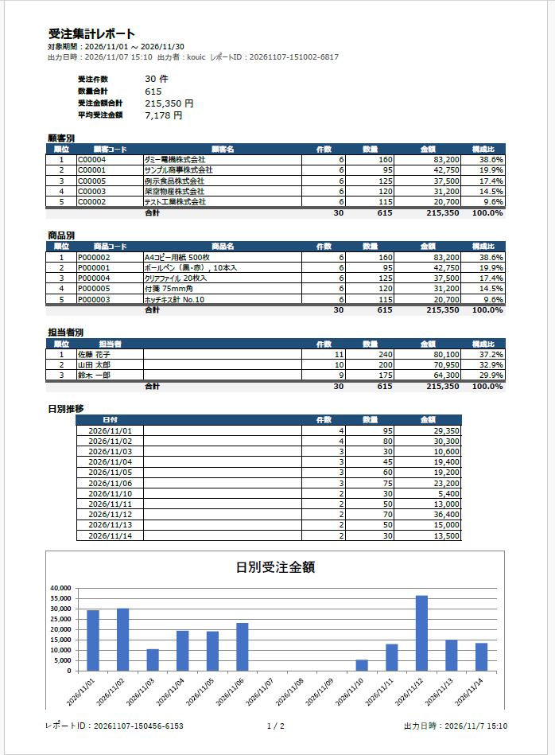
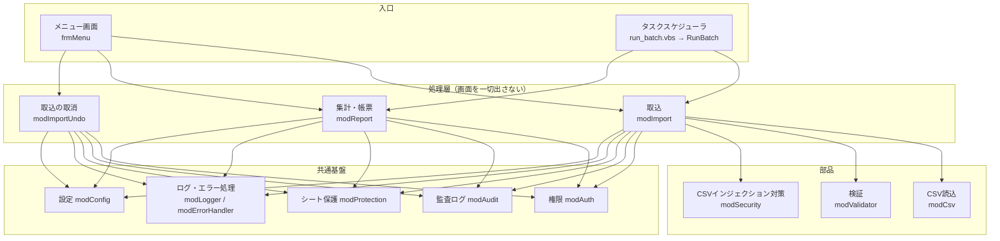

# VBA-Order-Automation

**受注CSVの取込・検証・集計・帳票出力を自動化する Excel VBA ツール**

「動くマクロ」ではなく、**現場で運用し続けられるシステム**として設計・実装しました。
運用負荷の軽減、セキュリティ、性能、保守性を、要件として最初から組み込んでいます。


---

## 想定した業務

> 毎月、担当者が取引先から届く受注CSVを手作業でExcelに貼り付け、集計して帳票を作っている。
> 文字コードの違いで文字化けする、同じファイルを二重に取り込む、数式入りの不正なデータが紛れ込む、
> 担当者しか手順を知らない（属人化）、といった問題がある。

このツールは、CSVを置くだけで **検証 → 取込 → 集計 → PDF・CSV出力** までを行い、毎朝の自動実行にも対応します。

## スクリーンショット

| 管理者のメニュー | 閲覧者のメニュー（権限のない操作は押せない） |
|---|---|
|  |  |

| 取込エラーの一覧（行・列・値・理由） | 月次レポート（PDF） |
|---|---|
|  |  |

## 主な機能

| 観点 | 実装内容 |
|---|---|
| **ユーザビリティ** | メニュー画面（権限に応じてボタンを切替、処理中の進捗表示）／エラーは「CSVの何行目・どの列・値・理由」を一覧表示／列の順番が違うCSV・全角数字も取込可／エラー時は問い合わせ番号を表示 |
| **運用負荷軽減** | 検証ルール（必須・型・桁数・範囲・形式）をシートで管理し、コード修正なしで変更可／タスクスケジューラによる毎朝の自動取込／取込ID単位の取消／取込前の自動バックアップ（世代管理）／ログの自動ローテーション |
| **セキュリティ** | ロールベースの権限制御（未登録は既定で拒否）／改ざん検知付きの監査ログ（SHA-256 ハッシュチェーン）／CSVインジェクション対策（取込・出力の両方）／秘密情報をソースに含めない設計　→ [SECURITY.md](SECURITY.md) |
| **非機能要件** | 10万行の取込を117秒から36.7秒に短縮（計測・分析の過程を記録）／文字コード自動判定（UTF-8 / Shift_JIS）／32bit・64bit 両対応　→ [docs/performance.md](docs/performance.md) |
| **保守性** | VBAのソースをテキストで Git 管理／102件の自動テスト（`RunAllTests` で一括実行）／Issue・PR・マイルストーンによる開発管理 |

## アーキテクチャ

画面（UI）と処理を分離しているため、同じ取込・集計の処理を、**画面操作**からも**無人実行**からもそのまま使えます。



詳細は [docs/design.md](docs/design.md) を参照してください。

## 設計のポイント

1. **測ってから直す性能改善**　処理を区間に分けて計測し、遅い原因を特定してから改善しました。最初の見立てが外れたことも含めて [記録](docs/performance.md) しています（117秒 → 36.7秒）。
2. **「必ず元に戻す」仕組み**　画面更新の停止やシート保護の一時解除は、クラスの破棄時に自動で元に戻します（RAII パターン）。エラーで処理が止まっても、Excel が固まったままになりません。
3. **権限は二重にチェック**　画面のボタンを押せなくするだけでなく、処理の入口でも必ず権限を確認します。ユーザー名は、書き換え可能な環境変数ではなく Windows API から取得します。
4. **改ざんを「検知」する監査ログ**　Excel の保護は破られる前提で、各行に前の行を含めたハッシュ値を付け、書換え・削除を検知できるようにしました。
5. **秘密情報を持たないソースコード**　保護パスワードは初期設定時に安全な乱数で生成し、通知先の URL は環境変数から読みます。公開リポジトリから秘密情報が漏れません。
6. **止まらない無人実行**　1つのファイルの失敗で全体を止めず、書込中のファイルは次回に回し、二重起動を防ぎ、Excel のプロセスを残しません。
7. **VBAでも Git で開発**　ソースをテキストで書き出して差分を管理し、書き出し忘れはコミット時に自動で検知します。文字コード（Shift_JIS）の違いは `.gitattributes` で吸収しています。

## クイックスタート

### 動作環境
- Windows 10 / 11
- Microsoft 365 または Excel 2016 以降のデスクトップ版（32bit / 64bit）
- Mac 版 Excel には対応していません（Windows API を使用しているため）

### 試し方
1. [Releases](https://github.com/KoichiKurita/VBA-Order-Automation/releases/latest) から `OrderTool.xlsm` と サンプルCSV をダウンロードし、同じフォルダに置きます。
2. ダウンロードしたブックを右クリック → **プロパティ** → 「**許可する**」にチェックを入れます。
   （インターネットから取得したファイルのマクロは、Windows の既定で無効になるため）
3. ブックを開き、「コンテンツの有効化」を押します。メニューが表示されます。
4. メニューの「**初期設定（最初に1回だけ）**」を押します。あなたが管理者として登録されます。
5. 「受注CSVを取り込む」でサンプルCSVを取り込み、「月次レポートを作成する」で PDF を作成します。

| サンプルCSV | 内容 |
|---|---|
| `orders_202611_utf8.csv` | UTF-8（BOM付き）・20件。引用符内のカンマ・改行を含む |
| `orders_202611_sjis.csv` | Shift_JIS・10件。列の順番が違い、定義外の列を含む |
| `orders_202611_errors.csv` | エラーケース集。必須・形式・日付・範囲・列数・重複・数式様の値 |

自動実行（タスクスケジューラ）の設定は [運用手順書](docs/operations.md) を参照してください。

## テスト

VBE で `RunAllTests` を実行すると、102件の自動テストを一括で実行し、結果を Markdown で出力します。

| テスト | 件数 | 主な内容 |
|---|---:|---|
| Phase 2（CSV取込・検証） | 39 | CSVパーサー（RFC 4180）、文字コード判定、型・範囲・形式の検証、CSVインジェクション判定 |
| Phase 3（集計・帳票） | 21 | 集計結果を Excel の SUMPRODUCT で独立に検算、並び順、CSV出力のエスケープ |
| Phase 4（権限・監査・暗号） | 25 | SHA-256 の公開テストベクタとの照合、権限の対応表、監査ログの改ざん検知 |
| Phase 5（バッチ・通知） | 17 | JSONのエスケープ、書込中ファイルの判定、終了コード |

外部アドイン（Rubberduck 等）に依存しない自作のテスト基盤にしたのは、**Excel だけあれば誰でもテストを実行できる**ようにするためです。

## 開発の進め方

| 項目 | 内容 |
|---|---|
| ブランチ戦略 | GitHub Flow（main は保護し、PR 経由でのみ更新。Squash merge） |
| 管理 | Issue・マイルストーン（Phase 単位）・ラベル（観点別）で管理し、タグ・リリースを Phase ごとに作成 |
| VBA のソース管理 | `ExportAllModules` で `src/` にテキストとして書き出し、差分をレビュー |
| 書き出し忘れの防止 | ブックだけ変更されて `src/` が変わっていないコミットを、pre-commit フックで拒否（`git config core.hooksPath .githooks`） |
| 文字コード | VBE の書き出しは Shift_JIS。`.gitattributes` の `working-tree-encoding` でリポジトリ内は UTF-8 に変換し、GitHub 上で文字化けさせない |

## リポジトリ構成

```
VBA-Order-Automation/
├─ OrderTool.xlsm          開発用ブック
├─ src/                    VBAソース（ExportAllModules で書き出し）
│  ├─ modules/  classes/  forms/  documents/
├─ samples/                サンプルCSV（架空のデータ）
├─ scripts/                無人実行（run_batch.vbs）・タスク登録（register_task.ps1）
├─ docs/                   設計書・運用手順書・性能計測
├─ .githooks/              pre-commit フック
└─ SECURITY.md             セキュリティ設計と限界
```

## 今後の改善

- 取込日時・ファイル名を別の「取込履歴」表に分け、書込セル数を減らす（性能改善の候補）
- 監査ログを別サーバーへ転送し、末尾の削除・ファイルの作り直しも検知できるようにする
- 配布を Excel アドイン（.xlam）化し、データとプログラムを分離する

## ライセンス

[MIT License](LICENSE)　※ サンプルデータに含まれる会社名・人名はすべて架空のものです。
