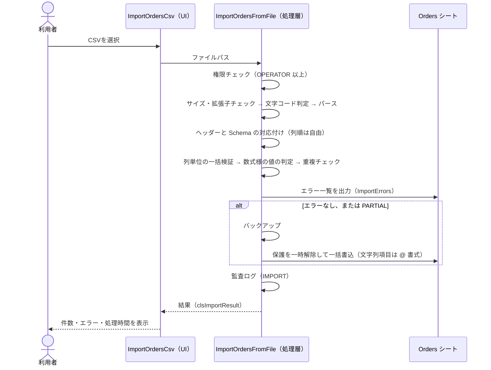
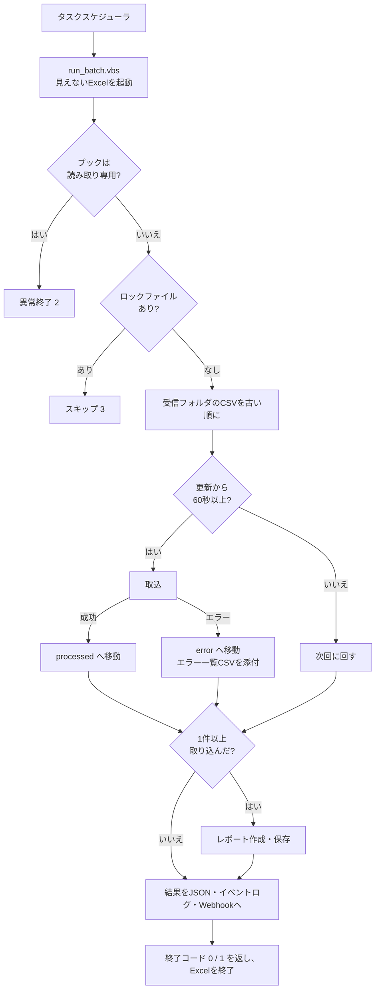

# 設計書

## 1. 目的と範囲

| 項目 | 内容 |
|---|---|
| 目的 | 受注CSVの取込・検証・集計・帳票出力を自動化し、手作業・属人化・データ不備による事故をなくす |
| 利用者 | 管理者（ADMIN）・取込担当者（OPERATOR）・閲覧者（VIEWER） |
| 範囲 | CSV取込（手動・自動）、入力検証、集計、帳票（PDF・CSV）出力、取込の取消、権限管理、監査 |
| 範囲外 | 受注データの手入力・編集画面、他システムとのAPI連携 |

## 2. 全体構成

### 2.1 レイヤー

| レイヤー | 役割 | 主なモジュール |
|---|---|---|
| 入口（UI） | 画面操作・ダイアログ・結果表示 | `frmMenu` / `modUI` / 各モジュールの UI 用 Sub |
| 入口（バッチ） | 画面を出さない無人実行 | `scripts/run_batch.vbs` / `modBatch` / `modNotify` |
| 処理層 | 業務処理。**MsgBox・ファイル選択を一切行わない** | `modImport` / `modReport` / `modImportUndo` |
| 部品 | CSV読込・検証・安全化 | `modCsv` / `modValidator` / `modSecurity` |
| 共通基盤 | 設定・ログ・エラー・権限・監査・保護・暗号 | `modConfig` / `modLogger` / `modErrorHandler` / `modAuth` / `modAudit` / `modProtection` / `modCrypto` |

処理層が画面に依存しないため、同じ関数（例：`ImportOrdersFromFile`）を画面操作とバッチの両方から呼び出せます。
処理層からの進捗は `clsAppState.ShowProgress` → `modUI.ReportProgress` を経由して画面に伝わり、画面がなければ何もしません。

### 2.2 モジュール一覧

| モジュール | 内容 |
|---|---|
| `modConfig` | Config シートの設定値を読み込み、キャッシュする。相対パスはブック基準で解決 |
| `modLogger` | アプリログ（TSV・日次ローテーション・保持期間で自動削除・改行の無害化） |
| `modErrorHandler` | 業務エラーとシステムエラーの区別、問い合わせ番号の表示、バッチモード |
| `modFileUtil` / `modBackup` | ファイル操作、世代バックアップ |
| `modCsv` | 文字コード判定（Windows API）、RFC 4180 準拠のパース、UTF-8 での書出し |
| `modValidator` | Schema シートに基づく検証と型変換（列単位の一括検証） |
| `modSecurity` | CSVインジェクションの判定、セル・CSVへの安全な書出し |
| `modImport` | 取込（UI・処理層）、Orders テーブルの作成・追加、エラー一覧 |
| `modImportUndo` | 取込ID単位の取消 |
| `modReport` | 集計（Dictionary による1パス集計）、Report シート、PDF・CSV出力 |
| `modAuth` | ユーザー識別（Windows API）、ロール、権限チェック、初期設定 |
| `modAudit` | 改ざん検知付きの監査ログ（SHA-256 ハッシュチェーン）と検証 |
| `modProtection` / `clsSheetUnlock` | シート保護と、処理中の一時解除（自動で再保護） |
| `modCrypto` | SHA-256、暗号論的に安全な乱数（Windows CNG） |
| `modAdmin` | 管理者機能（設定編集・ユーザー管理・保護・ログフォルダ） |
| `modBatch` / `modNotify` | 無人実行、結果の JSON・イベントログ・Webhook 通知 |
| `modRelease` / `modVersion` | 配布用ブックの作成、バージョン |
| `modVcs` | VBAソースの書出し（Git 管理用） |
| `modPerfTest` / `modProfile` | 性能計測、取込の詳細プロファイル |
| `modTestRunner` / `modTestPhase2`～`5` | 自動テスト |
| `clsAppState` | 画面更新・計算方法などの退避と自動復元（RAII） |
| `clsImportResult` / `clsReportData` | 処理結果を画面から切り離して受け渡すデータクラス |
| `clsStopwatch` | 高精度ストップウォッチ（QueryPerformanceCounter） |

## 3. 処理の流れ

### 3.1 取込

### 3.2 無人実行（バッチ）

## 4. データ設計

### 4.1 シート

| シート | 種類 | 内容 | 保護 |
|---|---|---|---|
| Config | 設定 | 運用設定（`tblConfig`：Key / Value / Description） | あり |
| Schema | 設定 | 項目定義（`tblSchema`：項目名・必須・型・桁数・範囲・形式・入力例） | あり |
| Orders | データ | 受注データ（`tblOrders`）。Schema の項目＋取込日時・取込ID・取込ファイル | あり |
| ImportErrors | 出力 | 直近の取込のエラー一覧（CSV行番号・列名・値・エラー内容） | あり |
| Report | 出力 | 集計レポート（主要指標・顧客別・商品別・担当者別・日別グラフ） | あり |
| _Users | 管理 | ユーザー一覧（`tblUsers`：UserName / DisplayName / Role / Enabled / Note）。VBA からのみ表示可 | あり |
| _Sys | 管理 | 保護パスワード（乱数で生成）・初期設定の日時と実行者。VBA からのみ表示可 | あり |

Orders・ImportErrors・Report は、最初の取込・帳票作成のときに自動で作られます。

### 4.2 Orders の項目

| 項目 | 型 | 必須 | 検証 |
|---|---|:---:|---|
| 受注番号 | 文字列 | ○ | 12文字以内・形式 `ORD-########`・重複不可（取込済み／ファイル内） |
| 受注日 | 日付 | ○ | `yyyy/mm/dd`（`-` 区切りも可）、2020/01/01～2099/12/31、存在しない日付は不可 |
| 顧客コード | 文字列 | ○ | 形式 `C#####` |
| 顧客名 | 文字列 | ○ | 50文字以内 |
| 商品コード | 文字列 | ○ | 形式 `P######` |
| 商品名 | 文字列 | ○ | 50文字以内 |
| 数量 | 整数 | ○ | 1～9999（全角数字も可） |
| 単価 | 小数 | ○ | 0～9999999（桁区切りのカンマは不可） |
| 担当者 | 文字列 |  | 20文字以内 |
| 備考 | 文字列 |  | 200文字以内（セル内改行可） |
| 取込日時 / 取込ID / 取込ファイル | 監査用 | － | 取込時に自動付与。取込ID単位で取消できる |

すべての文字列項目は、制御文字（タブ等）を不可とし、数式様の値（先頭が `=` `+` `-` `@` 等）は設定に従ってエラーにするか文字列として取り込みます。
項目の追加・変更は Schema シートの編集だけで行え、コードの修正は不要です。

### 4.3 ファイル

| ファイル | 形式 | 内容 |
|---|---|---|
| `logs/app_yyyymmdd.log` | TSV（Shift_JIS） | 日時 / レベル / 実行ID / ユーザー / 発生箇所 / メッセージ。保持期間を過ぎると自動削除 |
| `logs/audit.log` | TSV（Shift_JIS） | 日時 / ユーザー / 操作 / 結果 / 詳細 / 実行ID / ハッシュ。**自動削除しない** |
| `logs/launcher.log` | TSV（Shift_JIS） | VBScript の起動結果（Excel の外で起きた失敗も記録） |
| `output/batch/batch_<実行ID>.json` | JSON（UTF-8） | バッチの結果（状態・終了コード・ファイルごとの結果） |
| `output/受注集計_yyyymm_<実行ID>.pdf / .csv` | PDF / CSV（UTF-8 BOM付き） | レポート |
| `backup/OrderTool_yyyymmdd_hhnnss.xlsm` | Excel | 取込・取消の前のバックアップ（世代管理） |

## 5. 設定一覧（Config シート）

| キー | 既定値 | 内容 |
|---|---|---|
| AppName | 受注集計ツール | 画面のタイトル |
| LogDir / LogLevel / LogRetentionDays | logs / INFO / 30 | ログの保存先・出力レベル・保持日数 |
| BackupDir / BackupGenerations | backup / 10 | バックアップの保存先・保持世代数 |
| BackupBeforeImport | TRUE | 取込の前にバックアップするか（取消の前は常にバックアップする） |
| ImportKeyColumn | 受注番号 | 重複チェックに使う項目 |
| ImportMode | ALL_OR_NOTHING | ALL_OR_NOTHING（1件でもエラーなら取り込まない）/ PARTIAL（正常行のみ） |
| CsvInjectionPolicy | SANITIZE | SANITIZE（文字列として取込）/ REJECT（エラー扱い） |
| MaxImportFileSizeMB / MaxImportRows | 20 / 200000 | 取込の上限（大きなファイルによる停止の防止） |
| MaxErrorReport | 1000 | エラー一覧の最大表示件数 |
| InputDir / OutputDir | samples / output | ファイル選択の初期フォルダ・出力先 |
| ReportTopN | 20 | 順位表に表示する件数（超えた分は「その他」） |
| ShowMenuOnOpen | TRUE | ブックを開いたときにメニューを表示するか |
| PerfTestRows / PerfTestRepeat | 100000 / 3 | 性能計測の件数・回数 |
| BatchInboxDir / BatchProcessedDir / BatchErrorDir | batch\inbox / batch\processed / batch\error | バッチのフォルダ |
| BatchMinFileAgeSec | 60 | 更新からこの秒数が経つまで取り込まない |
| BatchLockTimeoutMin | 60 | ロックファイルの有効時間 |
| BatchCreateReport / BatchReportMonth | TRUE / CURRENT | バッチ後にレポートを作るか・対象月（CURRENT / PREVIOUS） |
| NotifyOn | ERROR | Webhook 通知の条件（ALWAYS / ERROR / NONE） |
| NotifyWebhookEnv | ORDERTOOL_WEBHOOK_URL | Webhook の URL を入れる**環境変数の名前**（URL そのものは書かない） |
| NotifyWebhookFormat | SLACK | SLACK / DISCORD |

## 6. エラー設計

| 区分 | 画面の表示 | ログ |
|---|---|---|
| 業務エラー（想定内） | エラーの内容と問い合わせ番号 | 詳細 |
| システムエラー（想定外） | 「予期しないエラーが発生しました」と問い合わせ番号のみ（内部情報を出さない） | 詳細（エラー番号・発生箇所・内容） |
| バッチ実行中 | 表示しない | 詳細＋結果JSON・イベントログ・通知 |

| エラーコード（vbObjectError +） | ログ上の番号 | 内容 |
|---:|---:|---|
| 1001 | -2147220503 | 設定キーが見つからない |
| 1101 | -2147220403 | ファイルが見つからない |
| 1102 | -2147220402 | CSVの形式不正（空・引用符の不一致・列不足など） |
| 1103 | -2147220401 | ファイルサイズ・行数の上限超過 |
| 1201 | -2147220303 | データ不備 |
| 1202 | -2147220302 | Schema・Orders の構成不正 |
| 1301 | -2147220203 | 権限なし・保護の解除不可 |
| 1401 | -2147220103 | バッチの実行条件を満たさない（読み取り専用など） |

問い合わせ番号（実行ID：`yyyymmdd-hhnnss-乱数`）は、アプリログ・監査ログ・結果JSONのすべてに記録されるため、利用者の報告からログの該当箇所をすぐに特定できます。

## 7. セキュリティ設計

[SECURITY.md](../SECURITY.md) を参照してください（脅威と対策の一覧、設計上の限界）。

## 8. 非機能要件

| 区分 | 要件 | 実現方法 |
|---|---|---|
| 性能 | 10万行の取込30秒以内（目標）／集計10秒以内 | 配列による一括読み書き、列単位の検証、Windows API による文字コード変換。結果は [performance.md](performance.md) |
| 可用性 | 取込の失敗でデータを壊さない | ALL_OR_NOTHING を既定、取込前のバックアップ、取込ID単位の取消 |
| 運用性 | 手作業なしで毎日動く | タスクスケジューラ、二重起動の防止、結果の通知 |
| 保守性 | 仕様変更にコード修正なしで対応 | Schema・Config による設定の外部化、自動テスト、Git 管理 |
| 移植性 | 32bit / 64bit の Office で動く | `PtrSafe` / `LongPtr`、参照設定を使わない遅延バインディング |

## 9. 設計判断の記録

| 判断 | 理由 | 検討した別案 |
|---|---|---|
| 取込は ALL_OR_NOTHING を既定にする | 一部だけ取り込まれると、どこまで入ったかの確認が必要になる。重複チェックと組み合わせ「直して再取込するだけ」にする | PARTIAL（設定で切替可能にした） |
| 文字列項目は `@` 書式の列に書き込む | 数式の実行・先頭ゼロの消失・日付への変換を防ぎ、`'` を付ける方式より書込が約3割速い。安全性は計測マクロで確認 | 先頭に `'` を付ける方式（当初の実装） |
| 文字コード変換に Windows API を使う | ADODB.Stream は大きなファイルで極端に遅い（11MBで約27秒 → 1秒未満） | ADODB.Stream、先頭だけの判定 |
| 検証を列単位で行う | 処理内容より関数呼び出し（100万回）の負担が大きいことを計測で確認 | セル単位の関数呼び出し（当初の実装） |
| テストは自作の仕組みにする | Excel だけで誰でも実行できる。採用担当者・利用者の環境にアドインを求めない | Rubberduck |
| ユーザー名は Windows API で取得 | 環境変数 USERNAME は Excel の起動前に書き換えられる | `Environ("USERNAME")` |
| 保護パスワードは乱数で生成し、ブック内に保持 | 公開リポジトリのソースから漏れない。シート保護は誤操作防止が目的で、改ざんは監査ログで検知する | ソースへの直書き、外部ファイル（別PCで解除できなくなる） |
| 配布は初回セットアップ方式 | 配布用ブックに開発者の情報を残さず、最初に開いた人が管理者になる | 全員に権限を与えた状態での配布 |
| 自動実行は「ログオン中のみ」 | Microsoft はログオンしていない状態での Office の自動実行をサポートしていない | ログオン不要での実行 |
